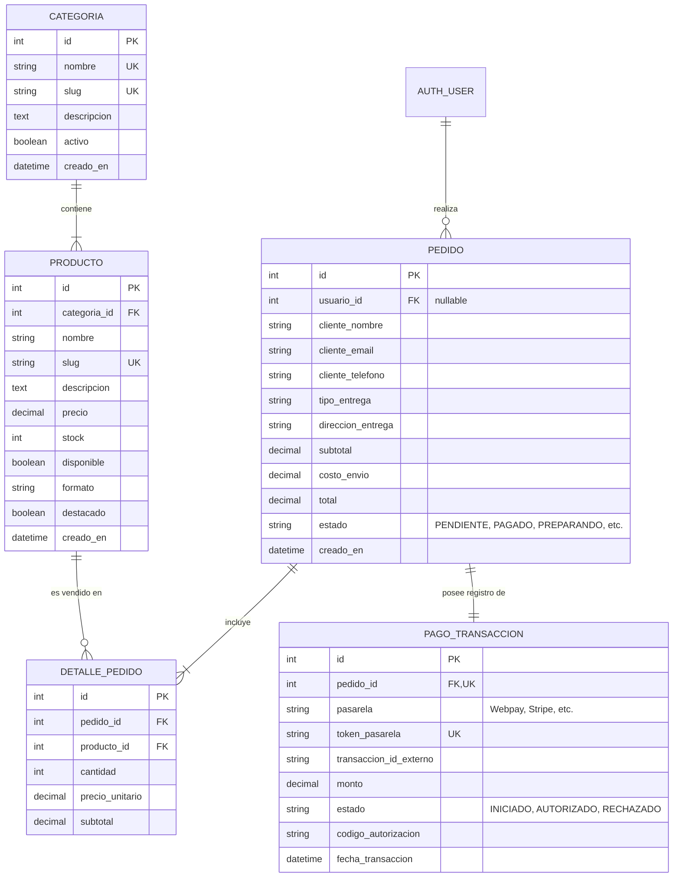

# Distribución de Persistencia

---

## 1. Fundamento Teórico y Criterio Arquitectónico

En el diseño de la arquitectura de la Cafetería "Paraíso del Café", se adoptó una estrategia de **Persistencia Políglota (Polyglot Persistence)**. Esta práctica consiste en seleccionar el motor de base de datos adecuado en función de la naturaleza, el ciclo de vida y los requisitos de consistencia de cada entidad:

| Criterio | Base de Datos Relacional (PostgreSQL) | Base de Datos NoSQL (MongoDB Atlas) |
|---|---|---|
| **Paradigma** | Tablas, filas, columnas, claves foráneas | Documentos BSON/JSON dinámicos |
| **Garantías** | **ACID** (Atomicidad, Consistencia, Aislamiento, Durabilidad) | **BASE** (Disponibilidad básica, estado flexible, consistencia eventual) |
| **Relaciones** | Fuertemente acopladas, integridad referencial estricta | Anidadas / Embebidas o independientes sin bloqueo referencial |
| **Uso Principal** | Finanzas, pedidos, cobros, inventario, control de stock | Payloads de webhooks externos, auditoría, consultas de contacto, fichas sensoriales |
| **Tolerancia a cambios** | Esquema rígido y estructurado (DDL controlado) | Esquema dinámico y flexible (Schemaless / Semi-estructurado) |

---

## 2. Matriz de Distribución de Entidades del Proyecto

A continuación se define la asignación formal de cada entidad a su respectivo motor de almacenamiento:

| Entidad / Modelo | Motor de BD | Justificación Técnica de la Asignación |
|---|---|---|
| **Usuarios y Autenticación** (`User`) | **PostgreSQL** | Manejo de sesiones, roles (Admin, Barista, Cliente), contraseñas con hash criptográfico e integración con Django Auth. |
| **Categorías** (`Categoria`) | **PostgreSQL** | Estructura jerárquica estricta para clasificar el catálogo (Grano, Molido, Repostería, Accesorios). |
| **Productos e Inventario** (`Producto`) | **PostgreSQL** | Precios en moneda legal (CLP), control de stock crítico para evitar ventas de café sin existencias reales. |
| **Pedidos** (`Pedido`) | **PostgreSQL** | Entidad transaccional clave de la compra. Requiere aislamiento estricto para evitar cobros duplicados o estados inconsistentes. |
| **Detalles del Pedido** (`DetallePedido`) | **PostgreSQL** | Integridad referencial con `Pedido` y `Producto`. Claves foráneas y protección contra borrado accidental de productos ya facturados (`PROTECT`). |
| **Transacciones de Pago** (`PagoTransaccion`) | **PostgreSQL** | Registro contable formal: montos, tokens bancarios autorizados, códigos de aprobación y trazabilidad financiera. |
| **Logs Crudos de Pasarela** (`logs_pasarela_pagos`) | **MongoDB Atlas** | Payloads JSON variables y de alto volumen provenientes de Transbank Webpay/Stripe. Preserva la respuesta original en caso de disputas bancarias. |
| **Consultas de Contacto** (`mensajes_contacto`) | **MongoDB Atlas** | Procedentes del formulario `/contacto`. Esquema flexible que soporta datos adicionales (teléfono, empresa, evento) sin alterar la BD relacional. |
| **Fichas Sensoriales de Café** (`fichas_tecnicas_cafe`) | **MongoDB Atlas** | Atributos botánicos variables por lote de café: orígenes, altitudes (m.s.n.m.), procesos (Lavado/Honey/Natural), notas de cata y curvas de tueste. |
| **Reseñas y Calificaciones** (`resenas_productos`) | **MongoDB Atlas** | Opiniones de clientes, valoraciones de 1 a 5 estrellas, tags y feedback informal. Alta concurrencia de lectura sin carga transaccional. |

---

## 3. Diagrama Entidad-Relación: Modelos en PostgreSQL



---

## 4. Estructura de Documentos en MongoDB Atlas

### 4.1. Colección `logs_pasarela_pagos`
Registra la auditoría forense de cada interacción con la pasarela externa de pago:

```json
{
  "_id": { "$oid": "67087f9e8a719c0012ab3451" },
  "pedido_id": 105,
  "pasarela": "Webpay Plus (Transbank)",
  "accion": "CONFIRMAR_TRANSACCION",
  "timestamp": { "$date": "2026-10-10T21:45:00.000Z" },
  "ip_origen": "190.160.12.85",
  "status_code": 200,
  "exito": true,
  "payload_crudo": {
    "vci": "TSY",
    "amount": 18900,
    "status": "AUTHORIZED",
    "buy_order": "ORD-105-2026",
    "session_id": "sess_89412a87",
    "card_detail": {
      "card_number": "6623"
    },
    "accounting_date": "1010",
    "transaction_date": "2026-10-10T21:44:58.000Z",
    "authorization_code": "121340",
    "payment_type_code": "VN",
    "response_code": 0,
    "installments_number": 0
  }
}
```

### 4.2. Colección `fichas_tecnicas_cafe`
Permite asociar atributos sensoriales y botánicos altamente dinámicos sin sobrecargar la tabla relacional de productos:

```json
{
  "_id": { "$oid": "6708811e8a719c0012ab3452" },
  "producto_id": 1,
  "nombre_comercial": "Café Geisha Paraíso Huila",
  "origen": {
    "pais": "Colombia",
    "departamento": "Huila",
    "finca": "La Esperanza",
    "productor": "Carlos Moncayo",
    "altitud_msnm": 1950
  },
  "variedad_botanica": ["Geisha"],
  "proceso": "Fermentación Anaeróbica 48h + Lavado",
  "perfil_tueste": "Medio Claro (Omniroast)",
  "notas_de_cata": ["Jazmín", "Melocotón", "Té verde", "Miel de flores"],
  "metricas_sensoriales": {
    "acidez": 4.8,
    "cuerpo": 3.2,
    "dulzor": 4.9,
    "puntaje_sca": 89.5
  },
  "metodos_sugeridos": ["V60", "Chemex", "Aeropress", "Kalita Wave"]
}
```

### 4.3. Colección `mensajes_contacto`
Captura consultas del formulario `/contacto` de manera flexible:

```json
{
  "_id": { "$oid": "6708823f8a719c0012ab3453" },
  "nombre": "Valentina Henríquez",
  "email": "valentina@agencia.cl",
  "asunto": "Cotización Evento de Degustación Corporativa",
  "mensaje": "Hola, nos gustaría consultar si disponen de servicio de barista a domicilio para 40 personas.",
  "datos_extra": {
    "empresa": "Tech Solutions",
    "fecha_evento_propuesta": "2026-11-15",
    "telefono": "+56987654321"
  },
  "leido": false,
  "respondido": false,
  "creado_en": { "$date": "2026-10-10T21:47:12.000Z" }
}
```

---

## 5. Implementación en Código
* **Modelos Relacionales (PostgreSQL):** Ubicados en `backend/api/models.py`.
* **Colecciones y Servicios No Relacionales (MongoDB Atlas):** Ubicados en `backend/api/mongo_collections.py` y `backend/config/mongodb.py`.
